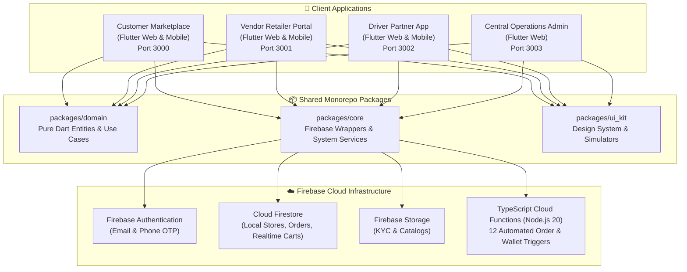

# 🛍️ Hyperlocal Fashion Marketplace

A complete, production-ready Hyperlocal Fashion & Apparel Marketplace ecosystem connecting local clothing stores across **Kubernagar (Ahmedabad)** and **Gandhinagar (Gujarat)** with nearby shoppers and local delivery partners.

---

## 🏗️ Architecture & Ecosystem



---

## 📱 Applications Overview

| Application | Path | Web Port | Description |
|---|---|---|---|
| **Customer App** | `apps/customer_app` | `3000` | Discovery in Kubernagar & Gandhinagar, live cart, size/color variant selector, COD/Razorpay checkout, order tracking. |
| **Vendor App** | `apps/vendor_app` | `3001` | Store open/closed toggle switch, live incoming orders pipeline, catalog CRUD, 10% platform commission wallet, referral Store Coins. |
| **Driver App** | `apps/driver_app` | `3002` | Online duty switch, delivery dispatch alerts, 5-step delivery pipeline (`accepted` $\to$ `delivered`), earnings ledger. |
| **Admin Web** | `apps/admin_web` | `3003` | Store verification & KYC approval table, driver partner fleet status, GMV & platform commission metrics. |

---

## 📦 Shared Packages

- **`packages/domain`**: Pure Dart entities (`UserEntity`, `StoreEntity`, `ProductEntity`, `OrderEntity`, `DeliveryEntity`, `AddressEntity`, `CartItemEntity`), repository interfaces, and failure definitions.
- **`packages/core`**: Firebase service wrappers (`AuthService`, `FirestoreService`, `FunctionsService`, `StorageService`, `NotificationService`, `RemoteConfigService`).
- **`packages/ui_kit`**: Unified theme tokens, buttons, inputs, shimmer loaders, and responsive `PhoneSimulatorWrapper` for web preview.

---

## 🚀 Quickstart Guide

### 1. Run Web Simulators (Side-by-Side)
```bash
# Terminal 1: Customer App
cd apps/customer_app
flutter run -d web-server --web-port 3000 --web-hostname localhost

# Terminal 2: Vendor App
cd apps/vendor_app
flutter run -d web-server --web-port 3001 --web-hostname localhost

# Terminal 3: Driver App
cd apps/driver_app
flutter run -d web-server --web-port 3002 --web-hostname localhost
```

### 2. Run on Android Mobile (Wireless ADB)
```bash
adb connect 192.168.1.10:<PORT>
cd apps/customer_app
flutter run -d 192.168.1.10:<PORT>
```

---

## 📚 Documentation

Detailed technical documentation is available in the [`docs/`](./docs) folder:
- [Development Progress](./docs/PROGRESS.md)
- [System Architecture](./docs/ARCHITECTURE.md)
- [Master Plan & Checklists](./docs/PLAN.md)
- [Tech Stack & Decision Records](./docs/TECH.md)
- [Engineering Rules & Standards](./docs/RULES.md)
