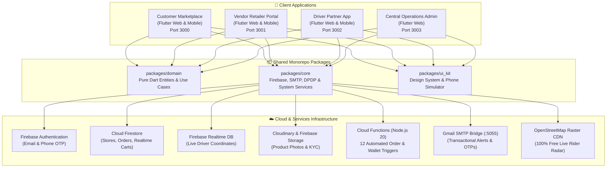

# 🛍️ XYZ Startup — Hyperlocal Fashion Marketplace

A complete, production-grade Hyperlocal Fashion & Apparel Marketplace connecting authentic retail boutiques across **Ahmedabad** (Kubernagar, Bodakdev, Sindhu Bhavan Road, Prahlad Nagar) and **Gandhinagar (Gujarat)** with nearby shoppers, dedicated local delivery partners, and central marketplace operations.

---

## 🏗️ Architecture & Ecosystem



---

## 📱 Applications Overview

| Application | Path | Web Port | Highlights & Key Capabilities |
|---|---|---|---|
| **Customer App** | `apps/customer_app` | `3000` | • **Whole Ahmedabad & Gandhinagar Coverage**: Kubernagar, Bodakdev, Sindhu Bhavan Road, Prahlad Nagar.<br>• **Zomato-Style Live Radar**: Free OpenStreetMap pop-up displaying nearby roaming couriers & live ETAs.<br>• **Live Order Route Map**: Interactive GPS route tracker on active orders.<br>• **Real-time Driver Chat**: In-app messaging with quick prompts (*"At the gate"*, *"Cash ready"*).<br>• **FashionBot Support AI**: Pre-trained customer support assistant.<br>• **48-Hour Size Exchange**: Doorstep swaps for apparel fit issues.<br>• **DPDP 2023 Consent Suite**: 25 statutory protections, granular toggles, and Grievance Desk. |
| **Vendor App** | `apps/vendor_app` | `3001` | • **Store Status Toggle**: Instant open/closed switch.<br>• **Order Pipeline**: Accept $\to$ Prepare $\to$ Ready for Pickup.<br>• **Catalog CRUD**: Product management with Cloudinary signed image uploads.<br>• **Duplicate-Protected Company Payouts**: UTR-backed remittance tracking with duplicate prevention.<br>• **10% Platform Fee & Store Coins**: Transparent fee ledger and referral wallet. |
| **Driver App** | `apps/driver_app` | `3002` | • **Online/Offline Duty Switch**: Available/on break status.<br>• **Atomic Order Acceptance**: Millisecond concurrency lock preventing dual-driver dispatch.<br>• **Free Google Maps Deep Links**: Universal turn-by-turn navigation for store pickup and customer dropoff.<br>• **5-Step Delivery Pipeline**: Assigned $\to$ Accepted $\to$ At Pickup $\to$ Picked Up $\to$ At Delivery $\to$ Delivered.<br>• **Cash-in-Hand Reconciliation**: Real-time COD ledger.<br>• **Hub Cash Handover with OTP**: 6-digit email OTP generated for hub desk settlement. |
| **Admin Portal** | `apps/admin_web` | `3003` | • **Live Marketplace Stream**: Real-time order monitoring with driver assignment locks.<br>• **Merchant KYC & Store Approval**: Retailer verification console.<br>• **Fleet Management**: Driver partner tracking and document checks.<br>• **Hub Counter Cash Settlement Desk**: Cash collection and 6-digit rider OTP verification desk.<br>• **Size Exchanges Console**: 48-hour return and replacement tracking. |

---

## 🛡️ India DPDP Act 2023 Statutory Compliance (The 25 Protections)

The customer app features a comprehensive, legally compliant **Statutory Legal & Consent Suite** under India’s Digital Personal Data Protection (DPDP) Act 2023, Consumer Protection (E-Commerce) Rules 2020, and Information Technology Act 2000:

1. **Precise Doorstep GPS Access**: Purpose-limited to active foreground delivery routing.
2. **Coarse City Cluster**: Neighborhood filtering (Ahmedabad & Gandhinagar).
3. **Camera for Size Exchange & KYC**: Optional photo evidence for fit issues and KYC.
4. **Scoped Storage for Tax Invoices**: Direct GST invoice downloads.
5. **Push Notifications Opt-In**: Explicit opt-in for order milestones and OTP alerts.
6. **Transactional Email & SMS**: TRAI DND-compliant receipts from `developermeetratwani@gmail.com`.
7. **Identity Data Minimization**: Recipient authentication strictly for fraud prevention.
8. **Encrypted Delivery Address**: House number and coordinates encrypted at rest and in transit.
9. **RBI Tokenized Payments**: Zero card number/CVV storage on servers (Razorpay PCI-DSS).
10. **Anonymized Crash Telemetry**: Performance logging via Firebase Crashlytics with zero PII.
11. **Unbundled Granular Consent**: Zero pre-ticked checkboxes; all optional toggles default to OFF.
12. **Right to Withdraw Consent**: 1-tap revocation in settings.
13. **Right to Erasure ("Right to be Forgotten")**: In-app account & data deletion request logged with statutory audit timestamps.
14. **Data Retention Schedule**: 6 financial years for GST tax audits; telemetry purged every 90 days.
15. **Third-Party Fiduciary Disclosure**: Transparency on Razorpay, Firebase, OpenStreetMap, and Google Maps.
16. **Child Data Safeguards**: Zero behavioral profiling or targeted advertising for minors under 18.
17. **Cookie & Local Storage Policy**: Technical session storage disclosures.
18. **Statutory Grievance Redressal Officer**: Mandatory IT Act / DPDP Act designation:
    - **Officer**: Meet Ratwani
    - **Designation**: Chief Grievance Redressal & Nodal Compliance Officer
    - **Email**: `grievance@xyzstartup.in` (Direct Tech: `developermeetratwani@gmail.com`)
    - **Physical Office**: Kubernagar Main Market, Ahmedabad - 382340, Gujarat, India
    - **Statutory SLAs**: Written acknowledgment within **48 hours**; Final resolution within **30 days**.
19. **24x7 Nodal Officer for Law Enforcement**: Point of contact for cyber crime units and police authorities.
20. **48-Hour Size Exchange & Return Policy**: Transparent terms for free doorstep clothing swaps.
21. **Platform Fee Transparency**: 10% marketplace commission, distance-based delivery fees, and applicable GST.
22. **72-Hour Data Breach Notification**: Mandatory protocol to report leaks to the Data Protection Board of India (DPBI).
23. **Domestic Data Residency**: All customer, store, and payment records localized in India (Google Cloud `asia-south1` Mumbai).
24. **Zero Unsolicited Telemarketing**: Strict TRAI Commercial Communications Customer Preference compliance.
25. **Exclusive Legal Jurisdiction**: Competent civil courts in **Ahmedabad, Gujarat, India**.

---

## 🛵 Zomato-Style Live Radar & En-Route Tracking

- **100% Free OpenStreetMap**: Utilizes OpenStreetMap raster tile CDN with **zero Google Maps API billing or quotas**.
- **Live Roaming Courier Radar**: Interactive bottom sheet displaying nearby delivery partners in Kubernagar, Sindhu Bhavan Road, Bodakdev, Prahlad Nagar, and Gandhinagar with live distance (km) and estimated arrival time (mins).
- **Active Order GPS Screen**: Live interactive map on `/orders/track/:id` showing store pin, courier scooter marker moving in real-time, customer destination, and polyline route.
- **Customer-Driver In-App Chat**: Direct messaging dialog with pre-built quick replies (*"I'm at the gate"*, *"Cash ready"*).
- **FashionBot AI Chatbot**: Domain-trained customer assistant answering questions regarding sizing, 48-hour exchanges, COD safety, and grievance escalation.

---

## ⚡ Cloudinary Signed Image Integration

Product photos, vendor storefronts, and size exchange photo evidence are uploaded directly to Cloudinary using authenticated **SHA-1 signed API uploads**:
- **Cloud Name**: `yjxpeklu`
- **Security**: Signed with server timestamp and secret key, avoiding unsigned upload restrictions.
- **Service**: Handled transparently by `packages/core/lib/services/cloudinary_service.dart`.

---

## 🚀 Local Development Quickstart

### 1. Start the Background Services
```bash
# Terminal 1: SMTP Mail Bridge (Gmail App Password)
cd packages/core
dart run bin/mail_server.dart
# Runs on http://localhost:5055 (delivers to developermeetratwani@gmail.com)
```

### 2. Run the 4 Flutter Applications
```bash
# Terminal 2: Customer Marketplace (Port 3000)
cd apps/customer_app
flutter run -d web-server --web-port 3000 --web-hostname localhost

# Terminal 3: Vendor Portal (Port 3001)
cd apps/vendor_app
flutter run -d web-server --web-port 3001 --web-hostname localhost

# Terminal 4: Driver Partner App (Port 3002)
cd apps/driver_app
flutter run -d web-server --web-port 3002 --web-hostname localhost

# Terminal 5: Central Admin Web (Port 3003)
cd apps/admin_web
flutter run -d web-server --web-port 3003 --web-hostname localhost
```

---

## 🌐 Production Deployment (Firebase Hosting)

All 4 web applications are configured for deployment to **Firebase Hosting** using multi-target sites in `firebase.json`:

```json
{
  "hosting": [
    { "target": "customer", "public": "apps/customer_app/build/web" },
    { "target": "vendor",   "public": "apps/vendor_app/build/web" },
    { "target": "driver",   "public": "apps/driver_app/build/web" },
    { "target": "admin",    "public": "apps/admin_web/build/web" }
  ]
}
```

### Automated Release Build & Deploy Script

Use the included PowerShell script to compile and deploy to Firebase Hosting:

```powershell
# Build & deploy all 4 applications in release mode
.\deploy_hosting.ps1 -All

# Or build and deploy a single target
.\deploy_hosting.ps1 -App customer
.\deploy_hosting.ps1 -App admin
```

### Production Custom Domains
Map the targets in the [Firebase Hosting Console](https://console.firebase.google.com/project/mars-1d49a/hosting/sites):
- **Customer App**: `app.xyzstartup.in` $\to$ target `customer`
- **Vendor Portal**: `vendor.xyzstartup.in` $\to$ target `vendor`
- **Driver Partner App**: `driver.xyzstartup.in` $\to$ target `driver`
- **Admin Console**: `admin.xyzstartup.in` $\to$ target `admin`

Firebase automatically provisions and renews SSL certificates for each custom domain.

---

## 📚 Technical Documentation

Detailed architecture specifications, security guidelines, and decision records:
- [System Architecture](./docs/ARCHITECTURE.md)
- [Master Implementation Plan](./docs/PLAN.md)
- [Development Progress Log](./docs/PROGRESS.md)
- [Engineering Rules & Standards](./docs/RULES.md)
- [Tech Stack & Decision Records](./docs/TECH.md)

---

## 📄 License
Proprietary software developed for XYZ Startup Ahmedabad & Gandhinagar. All rights reserved.
