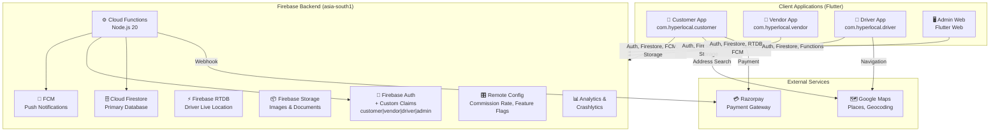
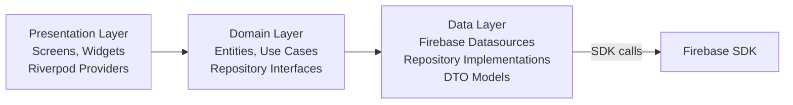
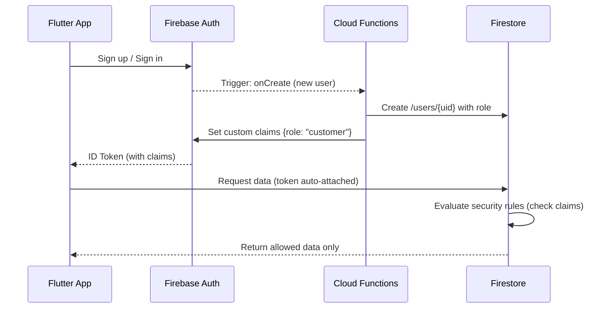
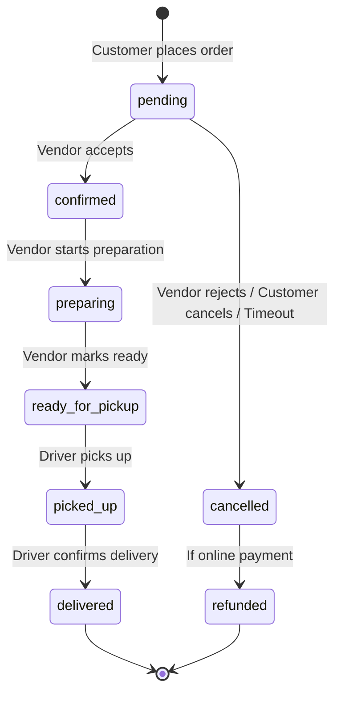
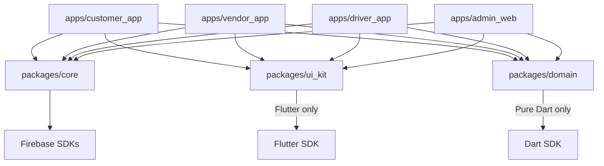
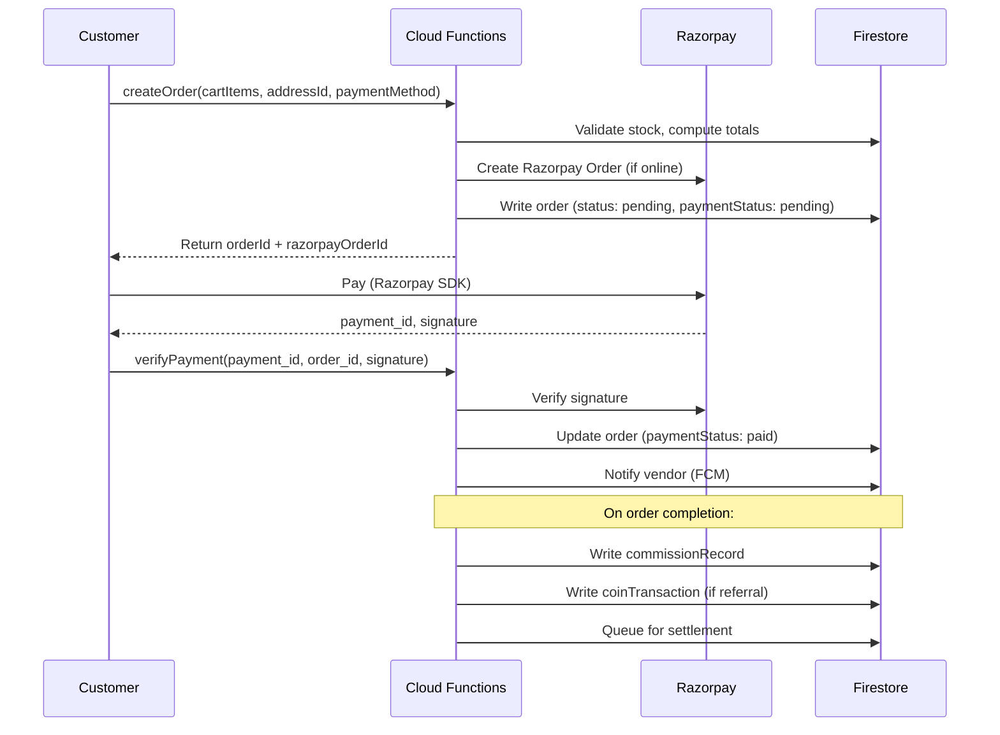

# 🏗️ Architecture — Hyperlocal Fashion Marketplace

> [!NOTE]
> This document is the single source of truth for the system architecture. All technical decisions must trace back to this document.

---

## 1. System Architecture Diagram



---

## 2. Application Architecture (per Flutter App)

Each Flutter application follows **Clean Architecture** with three layers:



| Layer | Responsibility | Firebase Access |
|---|---|---|
| **Presentation** | UI rendering, user interaction, state display | ❌ None |
| **Domain** | Business rules, use cases, entity definitions | ❌ None (pure Dart) |
| **Data** | Firebase SDK calls, data mapping, caching | ✅ Direct |

---

## 3. Firestore Database Schema

### 3.1 Collection Overview

```
Firestore Root
├── users/                    # Auth-linked base profiles
├── customerProfiles/         # Customer-specific data
├── vendorProfiles/           # Vendor-specific data
├── driverProfiles/           # Driver-specific data
├── stores/                   # Store listings
├── categories/               # Product categories (admin-managed)
├── products/                 # Product listings
│   └── {productId}/
│       └── variants/         # Subcollection: size/color variants
├── inventory/                # Stock levels per variant
├── addresses/                # Customer saved addresses
├── carts/                    # Active cart per customer
│   └── {customerId}/
│       └── items/            # Subcollection: cart line items
├── orders/                   # All orders
│   └── {orderId}/
│       └── items/            # Subcollection: order line items
├── payments/                 # Payment records (append-only)
├── deliveries/               # Delivery assignments
├── reviews/                  # Product/store reviews
├── referralCodes/            # Vendor referral codes
├── referralTransactions/     # Referral attribution log (append-only)
├── storeCoins/               # Coin balance per vendor
├── coinTransactions/         # Coin credit/debit log (append-only)
├── commissionRecords/        # Commission per order (append-only)
├── settlements/              # Vendor settlement batches (append-only)
├── promoCodes/               # Admin-created promo codes
├── promoUsage/               # Promo redemption log
├── notifications/            # Per-user notification inbox
└── supportTickets/           # Dispute and complaint tickets
```

---

### 3.2 Core Document Schemas

#### `users/{userId}`
```json
{
  "uid": "string",
  "email": "string | null",
  "phone": "string | null",
  "role": "customer | vendor | driver | admin",
  "displayName": "string",
  "photoUrl": "string | null",
  "isActive": true,
  "isDeleted": false,
  "createdAt": "Timestamp",
  "updatedAt": "Timestamp"
}
```

#### `customerProfiles/{userId}`
```json
{
  "userId": "string",
  "fullName": "string",
  "defaultAddressId": "string | null",
  "referredByVendorId": "string | null",
  "referralAttributedAt": "Timestamp | null",
  "totalOrders": 0,
  "createdAt": "Timestamp",
  "updatedAt": "Timestamp"
}
```

#### `vendorProfiles/{userId}`
```json
{
  "userId": "string",
  "businessName": "string",
  "ownerName": "string",
  "phone": "string",
  "gstNumber": "string | null",
  "kycDocumentUrls": ["string"],
  "approvalStatus": "pending | approved | rejected",
  "approvedAt": "Timestamp | null",
  "approvedBy": "string | null",
  "storeId": "string | null",
  "referralCode": "string",
  "coinBalance": 0,
  "totalEarnings": 0,
  "isActive": true,
  "createdAt": "Timestamp",
  "updatedAt": "Timestamp"
}
```

#### `driverProfiles/{userId}`
```json
{
  "userId": "string",
  "fullName": "string",
  "phone": "string",
  "vehicleType": "bike | cycle | auto",
  "vehicleNumber": "string",
  "licenseDocUrl": "string",
  "approvalStatus": "pending | approved | rejected",
  "isOnline": false,
  "lastSeenAt": "Timestamp",
  "totalDeliveries": 0,
  "totalEarnings": 0,
  "createdAt": "Timestamp",
  "updatedAt": "Timestamp"
}
```

#### `stores/{storeId}`
```json
{
  "vendorId": "string",
  "name": "string",
  "description": "string",
  "bannerImageUrl": "string",
  "logoImageUrl": "string",
  "categoryIds": ["string"],
  "location": {
    "geopoint": "GeoPoint",
    "geohash": "string",
    "address": "string",
    "city": "string",
    "pincode": "string"
  },
  "operatingHours": {
    "monday": { "open": "09:00", "close": "21:00", "isOpen": true },
    "tuesday": { "open": "09:00", "close": "21:00", "isOpen": true }
  },
  "isOpen": true,
  "isActive": true,
  "isDeleted": false,
  "rating": 0.0,
  "totalRatings": 0,
  "createdAt": "Timestamp",
  "updatedAt": "Timestamp"
}
```

#### `products/{productId}`
```json
{
  "storeId": "string",
  "vendorId": "string",
  "name": "string",
  "description": "string",
  "categoryId": "string",
  "imageUrls": ["string"],
  "basePrice": 0,
  "discountedPrice": 0,
  "currency": "INR",
  "isPublished": true,
  "isDeleted": false,
  "tags": ["string"],
  "totalSold": 0,
  "rating": 0.0,
  "totalRatings": 0,
  "createdAt": "Timestamp",
  "updatedAt": "Timestamp"
}
```

#### `products/{productId}/variants/{variantId}`
```json
{
  "productId": "string",
  "size": "S | M | L | XL | XXL | Free Size",
  "color": "string",
  "colorHex": "#FFFFFF",
  "additionalPrice": 0,
  "sku": "string",
  "stockCount": 0,
  "isAvailable": true,
  "createdAt": "Timestamp",
  "updatedAt": "Timestamp"
}
```

#### `orders/{orderId}`
```json
{
  "customerId": "string",
  "storeId": "string",
  "vendorId": "string",
  "driverId": "string | null",
  "deliveryAddressId": "string",
  "deliveryAddressSnapshot": {
    "line1": "string",
    "city": "string",
    "pincode": "string",
    "geopoint": "GeoPoint"
  },
  "status": "pending | confirmed | preparing | ready_for_pickup | picked_up | delivered | cancelled | refunded",
  "paymentMethod": "cod | online",
  "paymentStatus": "pending | paid | refunded | failed",
  "razorpayOrderId": "string | null",
  "razorpayPaymentId": "string | null",
  "promoCodeId": "string | null",
  "referralCodeId": "string | null",
  "pricing": {
    "productTotal": 0,
    "deliveryCharge": 0,
    "discount": 0,
    "coinRedemption": 0,
    "grandTotal": 0,
    "platformCommission": 0,
    "vendorEarning": 0,
    "driverEarning": 0
  },
  "cancellationReason": "string | null",
  "cancelledBy": "customer | vendor | admin | null",
  "cancelledAt": "Timestamp | null",
  "placedAt": "Timestamp",
  "confirmedAt": "Timestamp | null",
  "deliveredAt": "Timestamp | null",
  "createdAt": "Timestamp",
  "updatedAt": "Timestamp"
}
```

#### `deliveries/{deliveryId}`
```json
{
  "orderId": "string",
  "driverId": "string",
  "vendorId": "string",
  "customerId": "string",
  "pickupLocation": "GeoPoint",
  "dropLocation": "GeoPoint",
  "status": "assigned | accepted | at_pickup | picked_up | at_delivery | delivered",
  "assignedAt": "Timestamp",
  "pickedUpAt": "Timestamp | null",
  "deliveredAt": "Timestamp | null",
  "deliveryFee": 0,
  "createdAt": "Timestamp",
  "updatedAt": "Timestamp"
}
```

#### `commissionRecords/{recordId}`
```json
{
  "orderId": "string",
  "vendorId": "string",
  "orderTotal": 0,
  "commissionRate": 0.10,
  "commissionAmount": 0,
  "vendorEarning": 0,
  "settledAt": "Timestamp | null",
  "settlementId": "string | null",
  "createdAt": "Timestamp"
}
```

#### `coinTransactions/{txId}`
```json
{
  "vendorId": "string",
  "type": "credit | debit",
  "amount": 0,
  "reason": "referral_reward | redemption | admin_adjustment",
  "referenceId": "string",
  "balanceBefore": 0,
  "balanceAfter": 0,
  "createdAt": "Timestamp"
}
```

---

## 4. Authentication & Authorization Flow



### Role Custom Claims

| Claim | Value | Set By | When |
|---|---|---|---|
| `role` | `customer` | Cloud Function | Auto on registration |
| `role` | `vendor` | Cloud Function | Admin approves vendor |
| `role` | `driver` | Cloud Function | Admin approves driver |
| `role` | `admin` | Manual / Cloud Function | Bootstrapped |
| `vendorId` | store document ID | Cloud Function | Vendor approved |
| `storeId` | store document ID | Cloud Function | Store created |

---

## 5. Order State Machine



---

## 6. Firebase RTDB — Driver Location Schema

```
/driver_locations/
└── {driverId}/
    ├── lat: 23.0225
    ├── lng: 72.5714
    ├── heading: 180.0
    ├── speed: 25.5
    ├── updatedAt: 1700000000000
    └── isOnline: true
```

> [!NOTE]
> This data is **ephemeral** — it represents the driver's current position only. No historical route is stored. Customer app subscribes to this RTDB path only while an active delivery is in progress.

---

## 7. Monorepo Package Architecture



### Package Responsibilities

| Package | Contains | Firebase |
|---|---|---|
| `packages/core` | Firebase Auth wrapper, Firestore service, Storage service, Functions client, FCM setup | ✅ Yes |
| `packages/domain` | Entities, Repository interfaces, Use cases, Failure types | ❌ None |
| `packages/ui_kit` | Theme, colors, typography, spacing, shared widgets, loading states | ❌ None |

---

## 8. Cloud Functions Architecture

```
functions/
├── src/
│   ├── auth/
│   │   ├── onCreate.ts          # Set custom claims on user creation
│   │   └── setUserRole.ts       # Admin-triggered role promotion
│   ├── orders/
│   │   ├── createOrder.ts       # Validate cart, reserve stock, create order
│   │   ├── acceptOrder.ts       # Vendor accepts → trigger driver assignment
│   │   ├── rejectOrder.ts       # Vendor rejects → trigger refund
│   │   ├── cancelOrder.ts       # Customer/admin cancellation
│   │   └── completeOrder.ts     # Delivery confirmed → trigger commission
│   ├── payments/
│   │   ├── createRazorpayOrder.ts   # Create Razorpay order
│   │   ├── verifyPayment.ts         # Verify signature, mark paid
│   │   └── processRefund.ts         # Trigger Razorpay refund
│   ├── delivery/
│   │   ├── assignDriver.ts      # Find nearest available driver
│   │   └── updateDeliveryStatus.ts
│   ├── commission/
│   │   ├── calculateCommission.ts   # Firestore trigger on order completion
│   │   └── createSettlement.ts      # Scheduled: daily/weekly batch
│   ├── referrals/
│   │   ├── attributeReferral.ts     # Link customer to referrer
│   │   └── issueCoins.ts            # Award Store Coins on qualifying purchase
│   ├── promos/
│   │   └── validatePromoCode.ts     # Validate and apply promo
│   └── notifications/
│       └── sendNotification.ts      # FCM wrapper
├── package.json
└── tsconfig.json
```

---

## 9. Store Discovery — Geolocation Query Strategy

```
1. Customer grants location permission
2. App gets lat/lng via geolocator
3. App computes geohash (precision 5 = ~5km cell)
4. Firestore query:
   WHERE geohash >= neighborGeohash[0]
   AND geohash <= neighborGeohash[8]
   ORDER BY distance (computed client-side after fetch)
   LIMIT 20
5. Client filters: isActive == true AND isOpen == true
6. Client sorts by actual distance using GeoPoint math
```

**Composite index required:**
```json
{
  "collectionGroup": "stores",
  "fields": [
    { "fieldPath": "location.geohash", "order": "ASCENDING" },
    { "fieldPath": "isActive", "order": "ASCENDING" }
  ]
}
```

---

## 10. Financial Flow Diagram



---

## 11. Key Technical Decisions

| Decision | Choice | Reason |
|---|---|---|
| NoSQL vs SQL | Firestore (NoSQL) | Firebase ecosystem, realtime, offline-first |
| Money storage | Integer (paise) | Avoid float rounding errors |
| Driver location | RTDB, not Firestore | High-frequency writes — RTDB is cheaper and faster |
| Geolocation queries | Geohash | Firestore doesn't support native geo queries |
| State management | Riverpod 2.x | Compile-safe, testable, works with code gen |
| Payment | Razorpay | Popular in India, good Flutter SDK, webhook support |
| Monorepo | Melos | Multi-package Flutter monorepo tooling |
| Commission config | Remote Config | Change rate without app update or redeployment |

---

## 12. Potential Technical Challenges

| Challenge | Risk | Mitigation |
|---|---|---|
| Geohash radius queries return false positives | Medium | Post-filter by exact distance client-side |
| Firestore transaction contention on stock | High | Use Firestore transactions in `createOrder` function |
| Driver assignment race condition | High | Use Firestore transaction for first-claim driver assignment |
| Razorpay webhook vs client callback | Medium | Always verify server-side; ignore client claims |
| Multi-vendor cart complexity | Medium | Phase 1: single-vendor per order; expand later |
| Cold start latency for Cloud Functions | Low | Use minimum instances for critical functions in production |
| Coin balance concurrency | Medium | Use Firestore FieldValue.increment for atomic updates |
