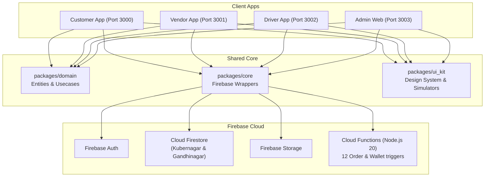

# 🗺️ Implementation Plan — Hyperlocal Fashion Marketplace
> Status: 🟢 **All Major Phases (1-6) Complete · Phase 7 Active**

---

## Architecture Overview

---

## Phase Checklist

- [x] **Phase 1: Foundation**
  - [x] Monorepo scaffold
  - [x] `packages/domain`: Freezed entities, repository interfaces
  - [x] `packages/core`: Auth, Firestore, Storage, Functions, Notifications
  - [x] `packages/ui_kit`: Theme, components, responsive phone simulator
  - [x] `firestore.rules` and `firestore.indexes.json`
- [x] **Phase 2: Customer Marketplace**
  - [x] Store & product browsing for Ahmedabad (Kubernagar) and Gandhinagar
  - [x] Realtime cart & checkout (COD & Razorpay)
  - [x] Order tracking screen
- [x] **Phase 3: Vendor Portal**
  - [x] Store open/closed toggle
  - [x] Order pipeline (Accept/Reject/Ready)
  - [x] Product catalog CRUD
  - [x] 10% commission tracking & Store Coins referral rewards
- [x] **Phase 4: Cloud Backend**
  - [x] 12 Cloud Functions for full order lifecycle and auto-dispatch
- [x] **Phase 5: Delivery Partner App**
  - [x] Online/offline duty switch
  - [x] 5-step delivery pipeline
  - [x] Driver earnings dashboard
- [x] **Phase 6: Admin Web Dashboard**
  - [x] Merchant approval console
  - [x] Driver fleet monitoring
  - [x] Marketplace metrics
- [x] **Phase 7: Testing & Deployment**
  - [x] Multi-port web simulation (`3000`, `3001`, `3002`)
  - [x] Native Android debug APK assembled
  - [ ] Device wireless install
  - [ ] Cloud deployment (`firebase deploy`)
